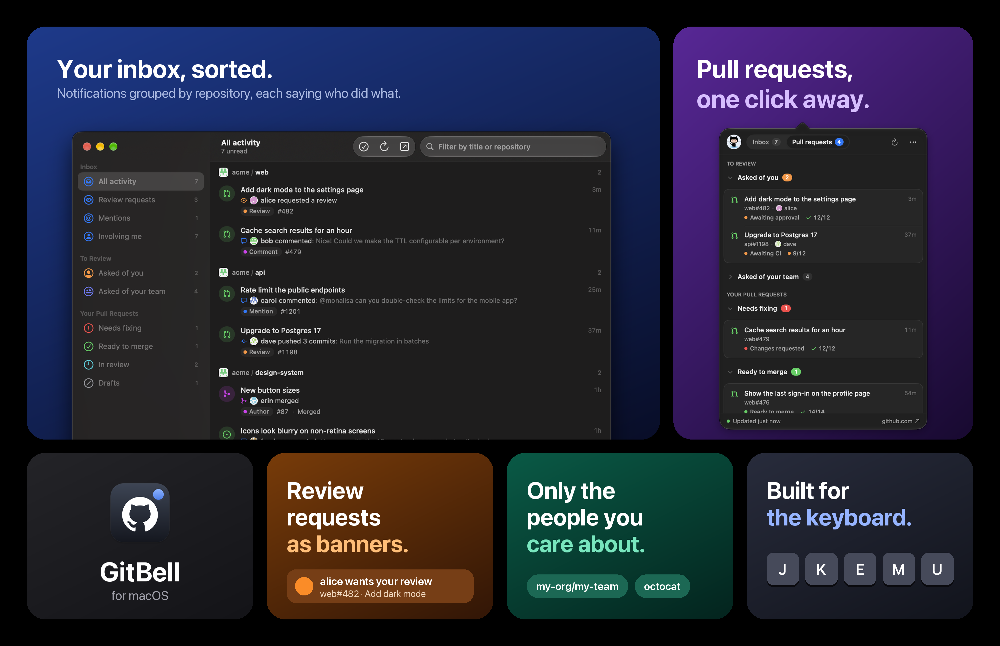

# GitBell

GitHub notifications and pull requests in a native Mac app.



- **Your turn:** everything waiting on you in one list: pull requests to review (asked of you or one of your teams), your pull requests to fix (failing checks named, one click from their logs, plus conflicts and requested changes), threads to reply to, CircleCI jobs on hold waiting for your approval (approve them from GitBell with a CircleCI token), your merges whose deploy or checks failed afterwards (they leave on their own once a later merge to the branch deploys), pull requests ready to merge, and approved ones you can merge while optional checks are still running. Checks your branch protection doesn't require never hold a pull request back. Notifications about a pull request fold into it instead of showing twice. Each group appears as soon as its search answers, so the list fills in rather than waiting on the slowest. Press E to hide an item until something changes on it, or show hidden items again with the eye button. The Dock icon counts these. Pull requests by other people that you've pushed commits to also show, under Contributing, with their checks and reviewers.
- **Your pull requests:** one page that follows each of yours from draft to live: Drafts, In review, Needs fixing, Ready to merge, Shipping (merged, deploying, or checks failing after the merge) and Shipped, where it stays for a day once it's live. Each row has a five-step strip (open, review, checks, merge, deploy) and says who or what it's waiting on and for how long, flagging the ones stuck too long: no review in two days, CI running over two hours, approved but not merged for a day, merged but not deployed after two hours. Deploys are recognised by job name (CircleCI's `deploy_*` jobs and the like).
- **Timeline:** press T, or the clock button on a row, for a pull request's history: opened, review requests, reviews, comments, pushes, the merge and its deploys, with how long each stretch took, from first review to merge to live.
- **Re-review:** pull requests you commented on or asked changes of, pushed to since, show in Your turn until you look again.
- **Pull requests:** review requests for you and your team, re-reviews, and the ones you're contributing to, with checks.
- **Repositories:** the repos you work in, ranked by your pull requests and reviews, plus pins, each with how much is waiting on you there. Each has a page with its main branch's checks, open pull requests, merges and time to merge over the last 30 days, and who's shipping. ⌘K jumps to any repo in your organizations.
- **Organizations:** a map of each organization's repositories, sized by commits or open pull requests over the last 30 days and coloured by language. Click a tile to open that repository.
- **Menu bar:** an optional menu bar icon that opens the window or a compact popover.
- **Notifications:** when someone requests your review, when checks fail on your pull request, when changes are requested, when it's ready to merge, when it deploys, or when its checks fail after merging.
- **Appearance:** light, dark or follow the system.
- **People filter:** only show activity from the people and teams you pick.
- **Keyboard:** ↑ ↓ or J K to move, Return or O to open, T timeline, E done, M read, C copy link, ⌘K go to repository.

## Install

Download the latest DMG from [Releases](https://github.com/tiagobabo/gitbell/releases) and drag GitBell to Applications. Requires macOS 14 or later.

GitBell isn't notarised yet, so macOS blocks it the first time. Open System Settings → Privacy & Security and click "Open Anyway", or run:

```sh
xattr -dr com.apple.quarantine /Applications/GitBell.app
```

GitBell asks to send notifications during setup. Allow it, with badges on, so the Dock icon can show how many things are waiting on you; you can change this later in System Settings → Notifications → GitBell.

GitBell updates itself with [Sparkle](https://sparkle-project.org): it checks for a new release once a day and asks before installing. If you're on 0.3.0, install the latest release by hand once.

## Sign in

The first launch walks you through setup: GitHub, an optional CircleCI token, notifications, and appearance. You can change all of it later in Settings.

GitBell uses your [GitHub CLI](https://cli.github.com) login if you have one. Otherwise paste a [classic personal access token](https://github.com/settings/tokens/new?scopes=notifications,repo,read:org&description=GitBell) with the `notifications` and `repo` scopes (plus `read:org` to filter by team). It's stored in your Keychain. After an update macOS may ask once whether GitBell can read it; click "Always Allow".

## Build from source

Needs Xcode and [XcodeGen](https://github.com/yonaskolb/XcodeGen) (`brew install xcodegen`).

```sh
git clone https://github.com/tiagobabo/gitbell.git
cd gitbell
./build.sh --install
```

`GITBELL_DEMO=1 build/GitBell.app/Contents/MacOS/GitBell` runs it with made-up data, which is handy for screenshots.

## License

[MIT](LICENSE). Icons from GitHub's [Octicons](https://github.com/primer/octicons).
